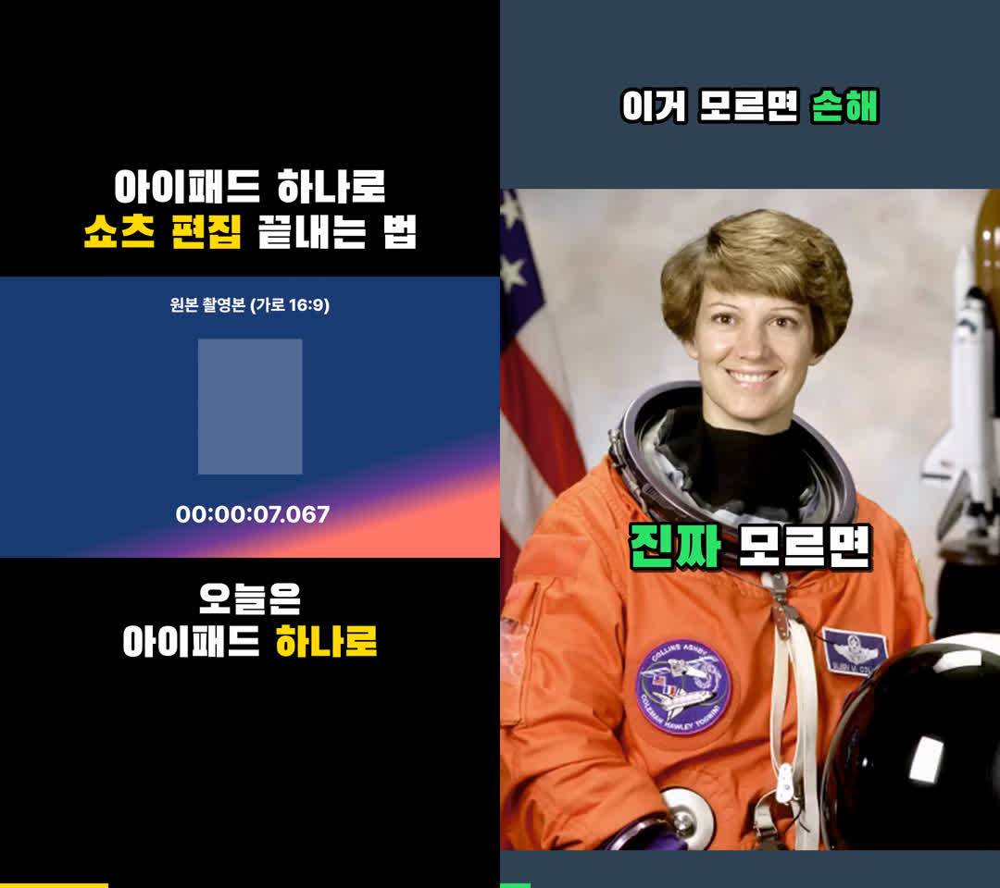
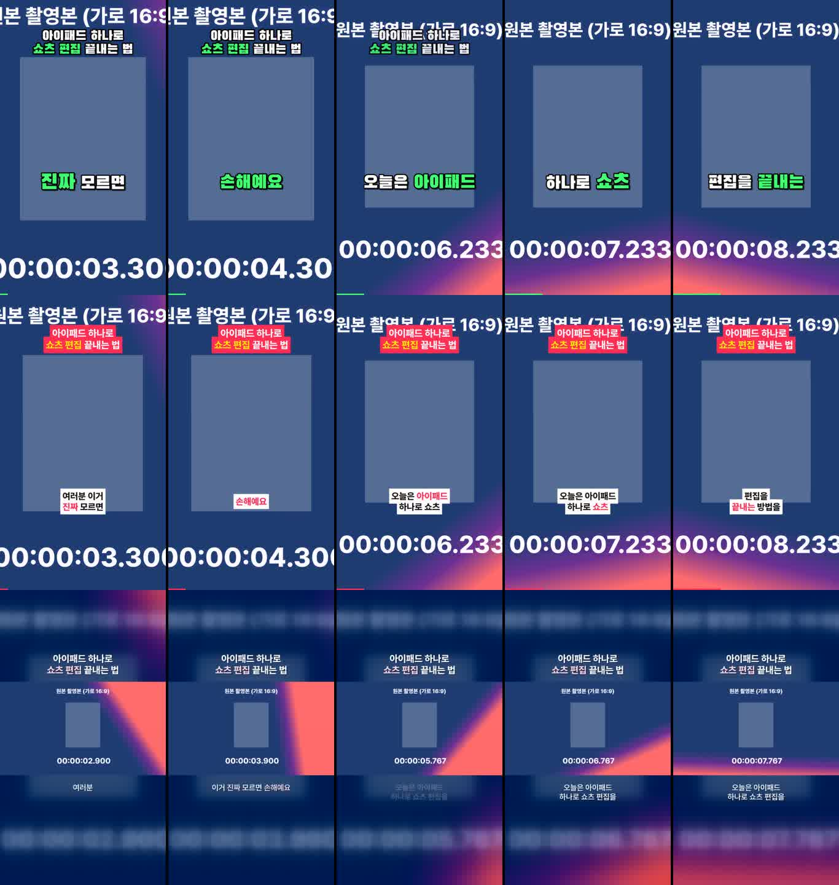

# Ssoy — 쇼츠 자동 편집 스튜디오

원본 영상을 **쇼츠·릴스·틱톡용 세로 영상**으로 자동 편집하는 도구입니다.
아이패드에서 Claude에게 말로 요청하면, Claude가 클라우드에서 이 도구로 편집하고 결과를 보여주며,
확인 후 Metricool을 통해 업로드(예약)까지 할 수 있게 만들었습니다.



## 무엇을 해주나

| 기능 | 설명 |
|---|---|
| 세로 9:16 재구성 | 가로 원본 → 얼굴 추적 크롭 / 레터박스(검은 배경 + 상단 제목) / 블러 배경 |
| 자동 컷 편집 | 무음·숨 고르기·"음/어" 추임새를 잘라 쉼 없이 몰아치는 리듬 (강도: tight/normal/loose) |
| 점프컷 줌 | 컷마다 100% ↔ 112% 번갈아 확대하는 요즘 토킹헤드 문법 |
| 자동 자막 | Whisper 음성 인식 → 짧은 덩어리 자막, 말하는 단어 하이라이트, 팝 애니메이션 |
| 강조 단어 | 숫자·"진짜/무조건/꿀팁/손해" 등은 자동으로 색 강조 (직접 지정도 가능) |
| 상단 제목 | `아이패드 하나로\|*쇼츠 편집* 끝내는 법` → 줄바꿈 + 노랑 강조 |
| 하이라이트 재배치 | 긴 원본에서 구간을 골라 **가장 센 장면을 맨 앞(훅)** 에 배치 |
| 오디오 | -14 LUFS 플랫폼 표준 음량, 배경음악 자동 더킹(말할 때 음악 줄이기) |
| 진행바 | 하단 진행바로 끝까지 보게 만드는 리텐션 장치 |
| 아이폰/아이패드 대응 | HDR(HLG) 영상 색 보정, 세로 회전 메타데이터 처리 |
| 레퍼런스 분석 | 잘 나가는 쇼츠의 컷 속도·훅 속도·음량 수치화 + 프레임 시트 → 커스텀 스타일로 저장 |
| 결과물 | MP4(1080×1920, H.264/AAC), 커버 이미지, SRT 자막 |

## 자막 스타일



| 이름 | 느낌 | 가로 원본 배치 |
|---|---|---|
| `variety` | 예능 자막형 — 검은고딕, 두꺼운 외곽선, 노랑 하이라이트, 상단 고정 제목 | 레터박스 |
| `pop` | 단어 팝업형 — 1~2단어씩 크게, 말하는 단어가 튀어오름 (정보·동기부여) | 얼굴 추적 크롭 |
| `box` | 틱톡 박스형 — 흰 박스 + 검정 글씨, 빨강 하이라이트 | 얼굴 추적 크롭 |
| `clean` | 감성 브이로그형 — 얇은 프리텐다드 + 은은한 그림자 | 블러 배경 |

레퍼런스를 분석해 새 스타일을 `shorts/styles/<이름>.json` 으로 추가할 수 있습니다.

## 아이패드에서 쓰는 법

1. **원본 올리기** — 아이패드 `파일` 앱에서 Google Drive(또는 Dropbox)에 원본을 올리고 공유 링크를 복사합니다.
2. **Claude에게 요청** — 예: "이 링크 영상으로 예능 스타일 쇼츠 만들어줘. 제목은 '○○○', 40초 안으로."
3. **결과 확인** — Claude가 결과 MP4와 커버를 보내줍니다. 수정 요청은 말로 ("자막 더 크게", "3번째 문장 빼줘").
4. **업로드** — "인스타 릴스로 내일 저녁 7시에 올려줘" → Claude가 Metricool로 예약합니다 (항상 최종 확인 후).

> ⚠️ 이 저장소는 **공개 저장소**입니다. 원본 영상을 GitHub에 직접 올리지 마세요 (`inbox/`, `work/`, `output/` 은 커밋되지 않습니다).

## 명령어 (Claude가 내부적으로 사용)

```bash
bash setup.sh                                   # 새 세션마다 1회: 패키지 + 폰트
python3 -m shorts fetch "<드라이브/드롭박스 링크>"   # → inbox/
python3 -m shorts transcribe inbox/raw.mp4       # 대본 → work/raw/transcript.txt
python3 -m shorts edit inbox/raw.mp4 --style variety \
  --title "아이패드 하나로|*쇼츠 편집* 끝내는 법" \
  --ranges "0:41-0:52,0:03-0:30" --replace "슈츠=쇼츠" --draft
python3 -m shorts edit inbox/raw.mp4 --plan work/raw/plan.json   # 계획 파일로 재렌더
python3 -m shorts analyze refs/hot.mp4 --transcript               # 레퍼런스 분석
python3 -m shorts styles                                          # 스타일 목록
```

주요 옵션: `--layout crop|letterbox|blur`, `--pace tight|normal|loose|off`, `--zoom alternate|punch|none`,
`--emphasis "단어1,단어2"`, `--bgm music.mp3 --bgm-db -20`, `--title-mode persistent|hook`, `--model medium`.
계획 파일 예시는 [`shorts/plan.example.json`](shorts/plan.example.json).

## 폰트

`setup.sh` 가 다음 무료 폰트를 내려받습니다 (모두 SIL Open Font License):
Black Han Sans(검은고딕), Jua, Do Hyeon — Google Fonts / Pretendard — orioncactus.
